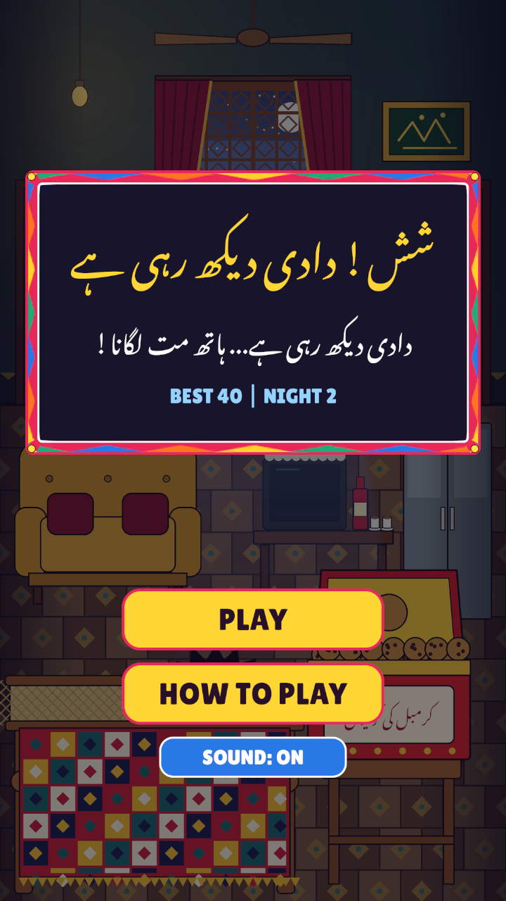
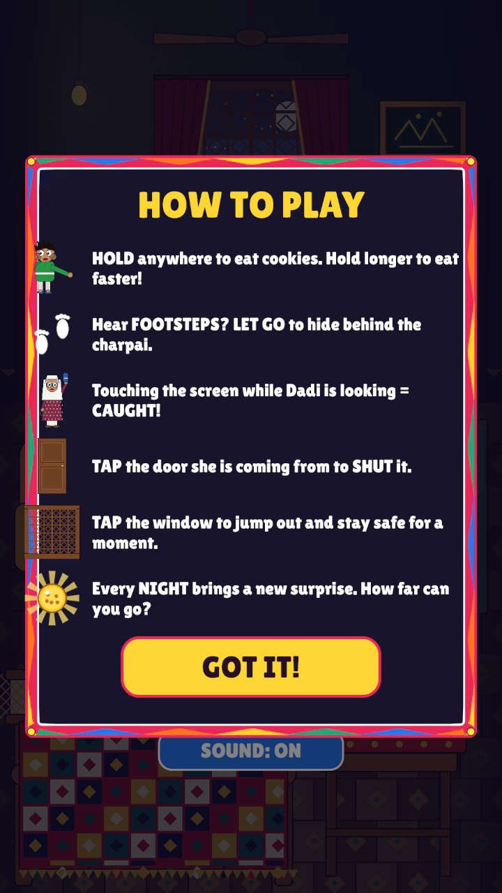
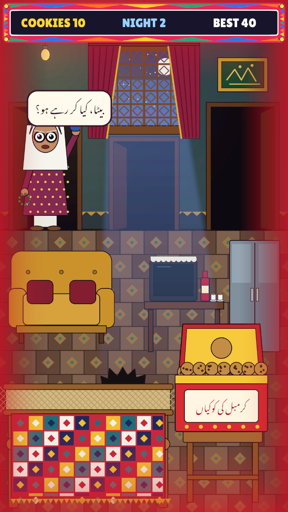
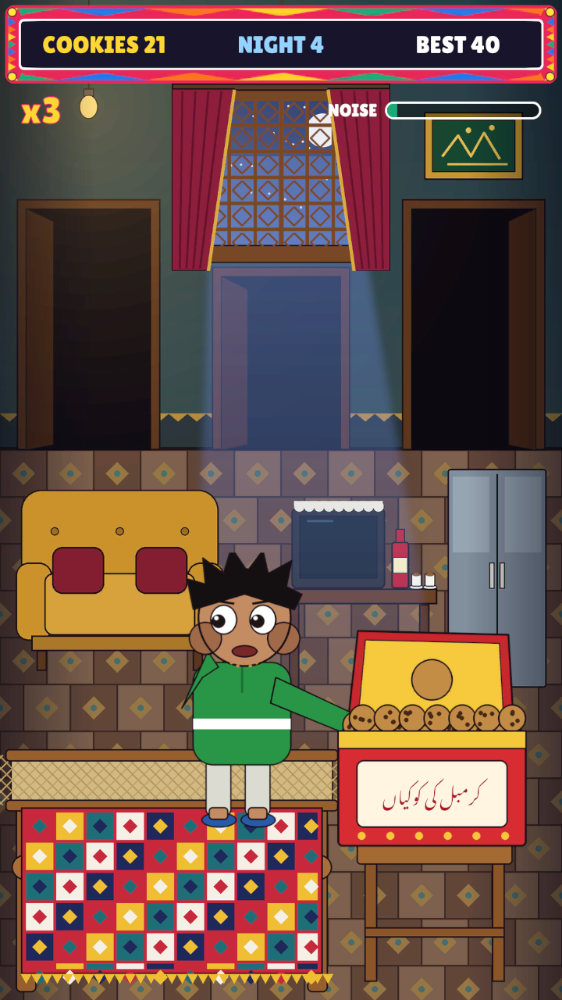
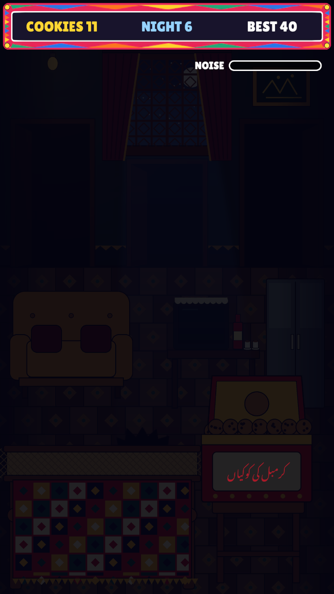
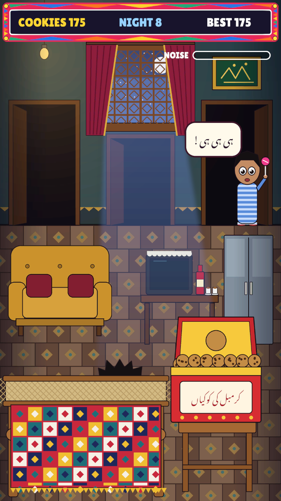
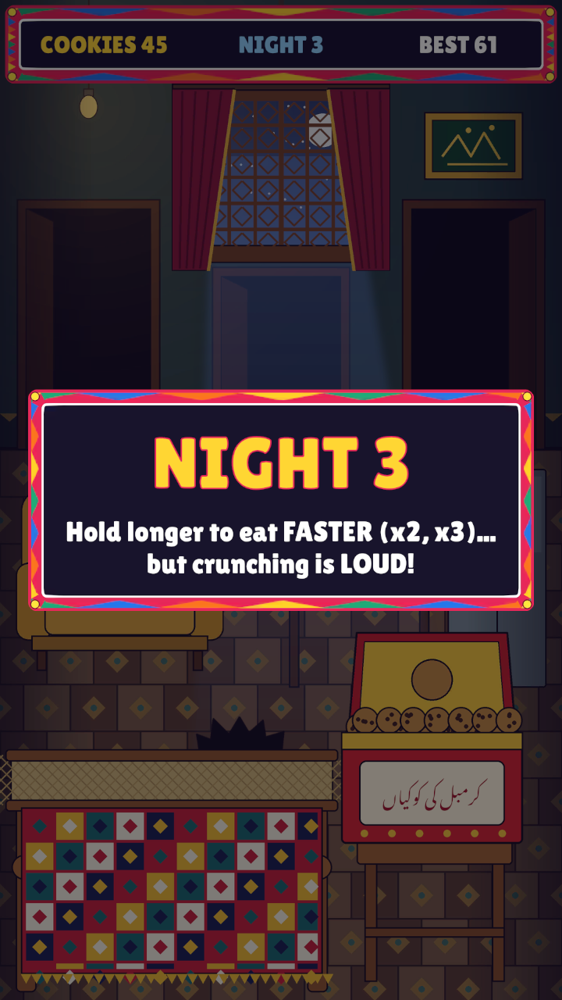
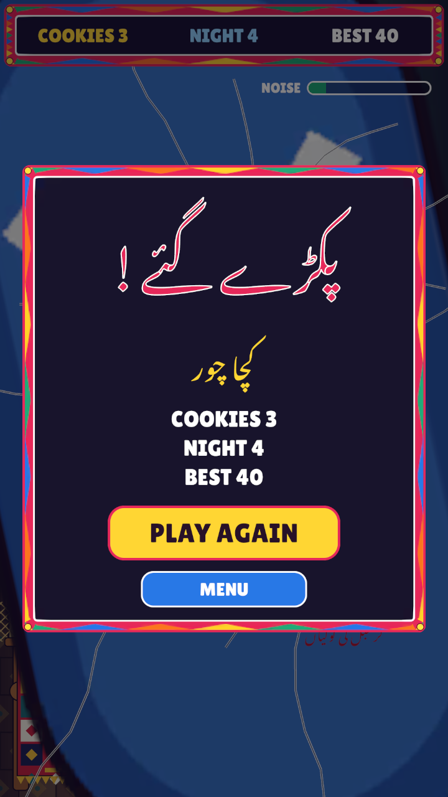

# Shh! Dadi Dekh Rahi Hai — شش! دادی دیکھ رہی ہے
### *Shh! Grandma's Watching*

> **TeknoFest Pakistan 4.0 · ACM NUCES Game Jam 2026 · Theme 03: "DON'T TOUCH"** — *"Some buttons are better left alone."*

It is the middle of the night in a Pakistani home. A hungry 9-year-old *bacha* sneaks into the lounge to raid the box of **Crumble ki cookiyan** next to the charpai. Hold your finger on the screen to stuff your face — but the moment you hear **Dadi's chappal shuffling** down the corridor, **let go!** If Dadi sees your finger on the screen, the chappal flies.

| | |
|---|---|
| **Genre** | Arcade / reflex / stealth-comedy, endless high-score |
| **Platform** | Android (portrait), touch only |
| **Engine** | Unity 6000.6.9f1 (Unity 6.6), Universal Render Pipeline 2D |
| **Session length** | 30 seconds to a few minutes per run |
| **Languages** | Urdu (Nastaliq script) for story text and characters, English for buttons, instructions and HUD |

## Core gameplay

The whole game is built around one mechanic that *is* the theme: **touching the screen is how you eat, and touching the screen is how you get caught.**

1. **HOLD** anywhere → the bacha eats cookies (score = cookies eaten).
2. **Listen.** Dadi's footsteps get louder from the side she is coming from (stereo-panned), and a strip of light appears under that door.
3. **LET GO** before she looks → the bacha ducks behind the charpai.
4. If you are touching the screen **at any moment** while Dadi is watching → **پکڑے گئے! (Caught!)** — she throws her chappal, the screen cracks, the phone vibrates. Game over.

Every **Night** has a cookie target and adds one new twist, so the game keeps getting harder and more surprising:

| Night | Cookies to clear | New twist |
|---|---|---|
| 1 | 10 | Basics + tutorial (time slows down the first time you need to let go) |
| 2 | 25 | Tap the door she is coming from to **shut it** — she knocks and grumbles instead |
| 3 | 45 | **Greed combo:** hold longer to eat ×2, ×3… but the crunching fills a **NOISE** meter that wakes Dadi early |
| 4 | 70 | **Golden cookies** (+5) — only if you are eating when one shines |
| 5 | 100 | Dadi can peek through the **jali window**; tap the window to jump out and be safe for 3.5 s |
| 6 | 135 | **Load-shedding!** The lights go out — Dadi can't see, eat as fast as you can until the UPS beeps |
| 7 | 175 | Dadi gets suspicious: she leaves… then **turns back** with only a cough as warning (sofa spawn unlocks) |
| 8 | 220 | **Chotu**, the little brother, wanders in — if he sees you eating he shouts "دادی! دادی!" |
| 9+ | +50 each | Dadi had her chai: shorter sleeps, faster footsteps, more fake-outs |

Extra juice: **near-miss bonus** ("بال بال بچے!", +3 and slow-motion) for letting go at the last moment, fake-outs ("ہمم... کچھ نہیں"), praise every 10 cookies, a red edge glow whenever someone is watching, haptic taps on footsteps, and a funny **Urdu rank** at game over — from *کچا چور* (amateur thief) to *دادی کا بھی استاد!* (Dadi's own master). Best score and best night are saved on the device.

## Screenshots

| Start screen | How to play | Dadi is watching! |
|---|---|---|
|  |  |  |

| Greed combo ×3 + noise meter | Load-shedding frenzy | Chotu the snitch |
|---|---|---|
|  |  |  |

| Night card | Caught! (rank + score) |
|---|---|
|  |  |

## Install and play (APK)

**Download:** [`Builds/ShhDadi.apk`](Builds/ShhDadi.apk) (≈ 33 MB) — direct link: <https://github.com/Riayne/gccsangat_grandmaswatching/raw/main/Builds/ShhDadi.apk>

**Requirements:** Android **8.0 (API level 26) or newer**, 64-bit ARM device (arm64-v8a — almost every phone from the last 6–7 years). Headphones recommended (footsteps are stereo-panned).

1. Download `ShhDadi.apk` on the phone (or copy it to the phone's **Download** folder over USB).
2. Open the **Files** app → **Download** → tap **ShhDadi.apk**.
3. If Android blocks it: tap **Settings** → enable **Allow from this source** → go back.
4. Tap **Install**. If Google Play Protect warns about an unknown app, tap **More details → Install anyway** (the game is not on the Play Store).
5. Open **Shh Dadi** from the app drawer.

*Alternative (developer):* enable USB debugging and run `adb install -r Builds/ShhDadi.apk`.

## Controls

Touch only, portrait.

| Action | Control |
|---|---|
| Eat cookies | **Hold** anywhere on the screen |
| Hide behind the charpai | **Let go** |
| Shut the door Dadi is coming from | **Tap that door** while her footsteps are coming |
| Jump out of the window (safe 3.5 s, 8 s cooldown, from Night 5) | **Tap the window** while her footsteps are coming |
| Get caught | Touch the screen at all while Dadi (or Chotu) is looking 😬 |
| Menus | **PLAY**, **HOW TO PLAY**, **SOUND ON/OFF**, **PLAY AGAIN**, **MENU** buttons |

## Build from source

**Engine:** Unity **6000.6.9f1** with the **Android Build Support** module (including *OpenJDK* and *Android SDK & NDK Tools*). The project uses URP 2D, UI Toolkit and the Input System; all packages are listed in `Source/Packages/manifest.json` and are downloaded automatically by Unity.

| Package | Version | Used for |
|---|---|---|
| com.unity.render-pipelines.universal | 17.6.0 | 2D rendering (URP 2D template) |
| com.unity.inputsystem | 1.20.1 | Touch input (`Pointer`), UI input |
| com.unity.ugui | 2.6.0 | UI Toolkit text core, EventSystem |
| com.unity.2d.* (animation, sprite, tilemap, spriteshape, psdimporter, aseprite, tooling) | see manifest | Universal 2D template defaults (sprites) |
| com.unity.pipeline | 1.0.0 | Editor automation through the Unity CLI (editor-only) |
| com.unity.timeline, com.unity.visualscripting, com.unity.test-framework, com.unity.collab-proxy, com.unity.ide.rider, com.unity.ide.visualstudio, com.unity.learn.iet-framework | see manifest | Template defaults (not used by the game code) |

**Steps (Unity Hub):**
1. Clone the repo: `git clone https://github.com/Riayne/gccsangat_grandmaswatching.git`
2. In Unity Hub: **Add → Add project from disk** → select the **`Source/`** folder → open with **Unity 6000.6.9f1**.
3. Open the scene **`Assets/Scenes/Game.unity`** (the only scene).
4. **File → Build Profiles → Android → Switch Platform** (if not already Android).
5. Check **Player Settings**: portrait, Min API Level 26, IL2CPP, ARM64 (already set in the project).
6. **Build** → choose an output path such as `../Builds/ShhDadi.apk`.

**Steps (Unity CLI, optional):**
```bash
unity open Source                       # opens the project in the Editor
unity command build run --output-path ../Builds/ShhDadi.apk --scenes '["Assets/Scenes/Game.unity"]' --confirm true --project-path Source
```

To play in the Editor: open `Game.unity`, set the Game view to a portrait resolution (e.g. 1080×1920) and press Play; the mouse acts as a finger.

**Project layout**
```
├── README.md
├── LICENSE
├── Builds/ShhDadi.apk          final Android build (matches the source in this commit)
├── Docs/screenshots/           screenshots used in this README
└── Source/                     full Unity project
    ├── Assets/Scripts/         game code (one MonoBehaviour per file)
    │   ├── GameManager.cs        input, cookies, nights, combo/noise, golden cookie, near-miss, tutorial
    │   ├── DadiController.cs     Dadi's coroutine state machine, blackout, Chotu, double-check
    │   ├── Nights.cs             night targets and twists (tuning table)
    │   ├── UIController.cs       UI Toolkit screens and HUD
    │   ├── UrduText.cs / EnglishText.cs   all on-screen text
    │   └── Bacha, CookieBox, SpawnPoint, AudioManager, CameraFit, GameOverSequence, Haptics
    ├── Assets/UI/              Game.uxml + Game.uss (UI Toolkit)
    ├── Assets/Art, Assets/Audio, Assets/Fonts
    └── AgentScripts/           dev tools: art/audio generators, scene builder, automated play tests
```

**Technical notes**
- **Proper Urdu text:** TextMeshPro cannot join Urdu letters, so the UI uses **UI Toolkit with the Advanced Text Generator** (`-unity-text-generator: advanced`), the Noto Nastaliq Urdu font and right-to-left language direction.
- Dadi, Chotu and load-shedding are a simple **coroutine state machine** (`DadiController.cs`); difficulty is driven by the night number (`Nights.cs`).
- No physics: taps on doors/windows are tested against rectangles in world space.
- Automated play tests (`Source/AgentScripts/PlayTest.cs`, `MechanicsTest.cs`) simulate a finger and check every rule (eat, hide, door, caught, near-miss, combo/noise, golden cookie, load-shedding, Chotu, double-check, night progression, tutorial).

## Tools and software used

| Tool | Version | Used for |
|---|---|---|
| Unity Editor | 6000.6.9f1 | Game engine (URP 2D, UI Toolkit, Input System) |
| Unity Android Build Support (OpenJDK, SDK, NDK) | bundled with 6000.6.9f1 | Building the APK |
| Unity CLI (`unity`) + Unity Pipeline package | CLI 1.0.1 / package 1.0.0 | Driving the Editor from the terminal: scene building, play-mode tests, screenshots, APK builds |
| Claude Code (Anthropic), model Claude Opus 5.5 | 2026 | AI coding assistant — see *AI-generated content* below |
| Python | 3.14 | Running the art/audio generator scripts |
| Pillow | 13.0 | Drawing the 2D art (in `gen_art.py`) |
| NumPy | 2.5 | Synthesising the sound effects (in `gen_audio.py`) |
| Git + GitHub | — | Version control and hosting |
| Windows 11 | — | Development OS |

## Assets declaration

### Self-made assets

All art and sound in the game were created for this jam. Nothing was taken from an asset pack. They were **generated by our own scripts** (`Source/AgentScripts/art/gen_art.py` and `gen_audio.py`), which draw shapes and synthesise sounds from code. Those scripts were written with the AI assistant Claude Code (see below) under the team's direction.

| Asset | Type | Created by | Tool used |
|---|---|---|---|
| Lounge background (wall, floor tiles, doors, fan, bulb, TV with doily, Rooh Afza bottle, chai cups, almirah, calligraphy frame) — `bg_lounge.png` | 2D art | Team (generated by script, AI-assisted) | Python + Pillow |
| Jali window, curtains, moonbeam, sofa, charpai with rilli quilt, stool, door panel, light strip | 2D art | Team (generated by script, AI-assisted) | Python + Pillow |
| Bacha (eating / hiding), Dadi (+ window bust), Chotu | 2D character art | Team (generated by script, AI-assisted) | Python + Pillow |
| Crumble cookie box + lid, golden cookie, chappal, screen crack | 2D art | Team (generated by script, AI-assisted) | Python + Pillow |
| Truck-art UI frame, speech bubble, red watching glow, footsteps icon | UI art | Team (generated by script, AI-assisted) | Python + Pillow |
| Footsteps (chappal shuffle), crunch, knock, door close, sting, whoosh, glass break, jump, praise, cough, giggle, UPS beep, golden chime, night jingle, power-off | Sound effects | Team (synthesised by script, AI-assisted) | Python + NumPy |
| Ambient loop (ceiling fan + crickets) | Audio | Team (synthesised by script, AI-assisted) | Python + NumPy |
| All C# game code (`Source/Assets/Scripts/`) | Code | Team (AI-assisted) | Unity 6000.6.9f1, Claude Code |
| UI layout and styles (`Game.uxml`, `Game.uss`) | UI | Team (AI-assisted) | Unity UI Toolkit, Claude Code |
| Scene construction, test and build tools (`Source/AgentScripts/`) | Code (dev tools) | Team (AI-assisted) | Unity CLI, Claude Code |
| Game design, all Urdu & English game text, ranks | Design / writing | Team (design document by the team; text drafted with AI assistance) | — |

### Open-source and third-party assets

| Asset | Type | Author | Source | License |
|---|---|---|---|---|
| Noto Nastaliq Urdu | Font (Urdu text) | The Noto Project Authors (Google) | [github.com/google/fonts](https://github.com/google/fonts/tree/main/ofl/notonastaliqurdu) | SIL Open Font License 1.1 (`Source/Assets/Fonts/OFL-Noto.txt`) |
| Lilita One | Font (English text) | Juan Montoreano | [github.com/google/fonts](https://github.com/google/fonts/tree/main/ofl/lilitaone) | SIL Open Font License 1.1 (`Source/Assets/Fonts/OFL-LilitaOne.txt`) |
| Universal RP, Input System, uGUI/UI Toolkit, 2D packages, Timeline, Test Framework | Engine packages | Unity Technologies | Unity Package Manager | Unity Companion License |
| Visual Scripting | Engine package (template default, unused) | Unity Technologies | Unity Package Manager | Unity Package Distribution License |
| Unity Pipeline (`com.unity.pipeline`) | Editor tool package (editor-only) | Unity Technologies | Unity Package Manager | Unity Terms of Service |
| Unity Engine | Engine | Unity Technologies | unity.com | Unity Personal license |
| Pillow, NumPy | Python libraries (development tools only, not shipped) | Pillow / NumPy contributors | pypi.org | MIT-CMU (HPND) / BSD-3-Clause |

No Asset Store assets, sample packs, or copyrighted brand art are used. The "Crumble ki cookiyan" box is our own drawing (name and design from the team's concept), not a real product's packaging.

### AI-generated content

We used **Claude Code** (Anthropic's AI coding assistant, model *Claude Opus 5.5*) during development:

- **Code:** wrote and debugged the C# game scripts, the UI Toolkit UXML/USS, and the editor tooling (scene builder, automated play tests), following the team's game design document.
- **Art:** wrote the Python script `gen_art.py` that draws every sprite procedurally (no image-generation model was used; the images come from shape-drawing code).
- **Audio:** wrote the Python script `gen_audio.py` that synthesises every sound effect and the ambient loop (no audio-generation model was used).
- **Text:** helped write the Urdu and English in-game text, the How to Play cards, night descriptions, ranks, and this README.
- **Process:** drove the Unity Editor via the Unity CLI to build the scene, run play-mode tests, take the screenshots and build the APK.

The game concept, setting, characters, mechanics, theme interpretation and all design decisions came from the team.

## Team members and roles

> **TODO before submission: fill in every team member.**

| Name | Role |
|---|---|
| Riayne | *TODO: e.g. Team lead, game design, development* |
| *TODO* | *TODO* |

## License

Code and self-made assets: **MIT License**, see [`LICENSE`](LICENSE).
The two fonts are under the **SIL Open Font License 1.1** (licence files included next to the fonts), and Unity packages are under Unity's own licences.
